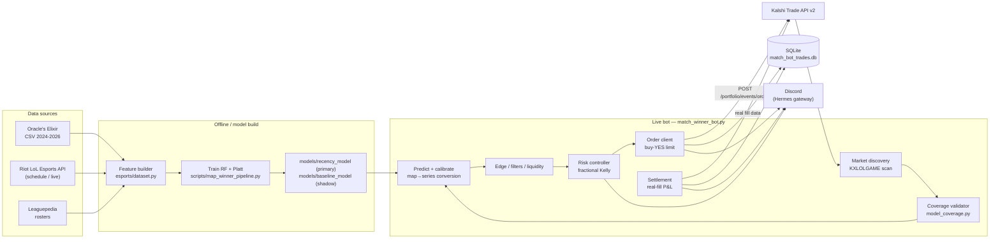

# prediction_bot — Kalshi LoL Trading Bot

An automated trading system that models professional League of Legends match outcomes and trades Kalshi's **KXLOLGAME** (LoL match/series winner) markets.

The system predicts a series-winner probability from a calibrated Random Forest model trained on Oracle's Elixir match data, compares that probability against the live Kalshi market price, and — when the model's edge exceeds a threshold — places a risk-managed buy-YES limit order. Positions are settled from Kalshi's actual fill data, and realized P&L is tracked against a persistent bankroll.

## Status

The match-winner bot is deployed as a `systemd` service (`lol-match-bot.service`) and places real orders on Kalshi's `KXLOLGAME` markets. It runs with a deliberately small configured bankroll and conservative position sizing.

> The repository's original `README`/`PROJECT.md`/`docs/architecture.md` described a paper-trading-only research prototype. That description is outdated: the deployed system has evolved into a live trading bot. See [docs/architecture.md](docs/architecture.md) for the current architecture.

A per-**map** winner model ("Model D", `KXLOLMAP` markets)  exists in the repository but is a **not-live** candidate (see "Implemented vs. planned" below).

## What the LoL bot actually does

1. **Discovers markets** — polls Kalshi's `KXLOLGAME` series for open match-winner markets.
2. **Parses matchups** — extracts the two teams from each market ticker/title and normalizes team identity.
3. **Checks model coverage** — rejects matches where either team lacks sufficient historical training data.
4. **Predicts** — produces a calibrated series-winner probability from the primary Random Forest model (with a shadow baseline model for divergence detection).
5. **Finds edge** — compares the calibrated probability against the market mid-price; converts map-level probability to series-level (Bo3 default; the conversion function also supports Bo5).
6. **Filters** — enforces time-window, liquidity, spread, and risk gates.
7. **Sizes** — fractional-Kelly position sizing scaled down by drawdown tier.
8. **Executes** — places a buy-YES limit order via Kalshi's `Trade API v2`, monitors it, and re-prices stale unfilled orders.
9. **Settles** — on resolution, fetches real fill data from Kalshi, computes realized P&L, and updates the bankroll.
10. **Reports** — sends trade, settlement, drawdown, and daily-summary alerts to Discord (via the Hermes gateway).

## Core technologies

| Layer | Technology |
|-------|------------|
| Language | Python 3.11 |
| Modeling | scikit-learn (`RandomForestClassifier` + Platt-scaled `LogisticRegression` calibration, `StandardScaler`) |
| Data | pandas, NumPy, Parquet, SQLite |
| Kalshi API | HTTPS (`external-api.kalshi.com/trade-api/v2`), RSA-PSS request signing (`cryptography`), httpx + tenacity |
| Esports data | Oracle's Elixir CSVs (historical), Riot LoL Esports APIs (schedule/live), Leaguepedia (rosters) |
| Persistence | SQLite (WAL mode) — `data/match_bot_trades.db` |
| Deployment | systemd (`lol-match-bot.service`) |
| Notifications | Discord via Hermes gateway (`hermes send`) |

## High-level architecture



See [docs/architecture.md](docs/architecture.md) for the full component diagram and data flow.

## Repository structure (LoL bot)

```
prediction_bot/
├── src/prediction_bot/
│   ├── trading/
│   │   ├── match_winner_bot.py      # LIVE LoL match-winner bot (KXLOLGAME) — main entrypoint
│   │   ├── model_coverage.py        # training-data coverage validation (rejects under-covered teams)
│   │   ├── team_identity.py         # team-name normalization / identity registry
│   │   ├── map_lifecycle.py         # map-level lifecycle (used by the shadow map bot)
│   │   └── order_client.py          # shared order client + reconciliation (used by other bots/CLI)
│   ├── kalshi/
│   │   ├── client.py                # Kalshi Trade API v2 client (RSA-PSS auth, rate limiting)
│   │   ├── signing.py               # RSA-PSS request signing
│   │   └── discovery.py             # esports market discovery / classification
│   ├── esports/
│   │   ├── dataset.py               # Oracle's Elixir loader + leakage-safe queries
│   │   ├── lolesports_client.py     # Riot LoL Esports API (persisted GW + live stats feed)
│   │   ├── leaguepedia_rosters.py   # Leaguepedia roster ingestion
│   │   ├── map_ticker.py            # KXLOLMAP ticker parser
│   │   └── map_winner_model.py      # map-winner model training
│   ├── tracking/                    # independent paper prediction tracker (not live trading)
│   └── config/settings.py           # env-driven configuration
├── models/                          # trained model pickles + metadata
│   ├── recency_model/               # PRIMARY live model (RF + Platt, 30 features)
│   ├── baseline_model/              # shadow baseline (comparison only)
│   └── map_winner_v2_shadow/        # Model D (48 features) — shadow candidate, NOT live
├── scripts/
│   ├── map_winner_pipeline.py       # walk-forward training/eval pipeline
│   └── run_tracking.py              # paper prediction tracker entrypoint
├── data/
│   ├── tier1_features.parquet       # feature matrix (Oracle's Elixir-derived)
│   ├── tier1_features_cito.parquet  # alternative Cito-derived features (optional)
│   └── match_bot_trades.db          # trade/position/bankroll persistence
├── docs/
│   ├── architecture.md              # current system architecture
│   ├── interview_walkthrough.md     # 7-minute technical walkthrough
│   └── task_plan.md                 # original 12-milestone plan + current status
└── tests/                           # pytest suite (unit + leakage + safety tests)
```

> **Out of scope here:** the repository also contains a Polymarket→Kalshi *copy-trading* system (`src/prediction_bot/copy_trading/`, `*_copy_bot` services) and other unrelated strategies. Those are intentionally **not** documented in this README or in `docs/architecture.md`.

## Local setup

```bash
git clone <repo-url>
cd prediction_bot

# Create a virtual environment and install
uv venv
source .venv/bin/activate
uv pip install -e ".[dev]"
```

Or with plain pip:

```bash
python -m venv .venv
source .venv/bin/activate
pip install -e ".[dev]"
```

### Environment variables

Copy `.env.example` to `.env` and fill in the Kalshi credentials. **Never commit `.env`** (already gitignored).

```bash
cp .env.example .env
```

Required for authenticated Kalshi access (market discovery + order placement):

- `KALSHI_API_KEY` — Kalshi API token
- `KALSHI_KEY_ID` — key ID (starts with `KK-`)
- `KALSHI_PRIVATE_KEY_PATH` — path to the RSA private key PEM (or inline PEM)

Optional:

- `FEATURE_PROVIDER` — `oe` (default, Oracle's Elixir features) or `cito` (Cito-derived features)

### Running the bot

```bash
# Dry-run / inspection only — validate startup checks and exit
python -m prediction_bot.trading.match_winner_bot --validate-only

# Live order execution (what the systemd service runs)
python -m prediction_bot.trading.match_winner_bot --live
```

The `--require-approval` flag sends the first scan cycle's proposed trades to Discord for manual approval instead of auto-executing — useful for verification runs.

## Testing

```bash
pytest
```

The suite covers Kalshi signing/auth, market discovery and ticker parsing, order-book/price extraction, order reconciliation, safety/risk logic, and leakage checks. Tests use mocked HTTP responses (no live API calls, no orders).

## Deployment overview

The live bot runs as a systemd service (`lol-match-bot.service`):

- `ExecStart`: `.venv/bin/python -m prediction_bot.trading.match_winner_bot --live`
- `Restart=always` (auto-restart on crash, 10s backoff)
- Timezone `Asia/Shanghai` (UTC+8); scans on a ~2-minute cadence inside the daily 08:00–24:00 CST window
- Logs to journald and `data/logs/match_bot.log`

On cold start the bot runs a six-point startup validation (service health, Kalshi API, market discovery, model inference, risk engine, order permission) and restores its bankroll and open positions from SQLite before trading.

Deployment configuration and secrets are intentionally **not** included in this repository.

## Implemented vs. planned

**Implemented (live):**

- Kalshi `KXLOLGAME` market discovery and execution (Trade API v2, RSA-PSS signing)
- Random Forest + Platt-calibrated series-winner model (recency-trained, 30 features)
- Model-coverage gating (rejects under-covered teams)
- Map→series probability conversion (Bo3 default; Bo5 supported)
- Fractional-Kelly sizing with drawdown-scaled risk tiers
- Buy-YES limit order execution, unfilled-order re-pricing, settlement from real fill data
- Persistent state (SQLite) with restart recovery
- Discord alerts and daily summaries

**Shadow / not live:**

- Per-map winner model "Model D" (48 features, `models/map_winner_v2_shadow/`) — trained and evaluated, but not deployed
- Map-winner bot (`research/map_winner_v2/map_bot_v2.py`) for `KXLOLMAP` markets — development/shadow only
- "Unified Platform v2" (`lol-match-platform.service`) — shadow mode, service disabled

**Planned / not yet built:**

- Uncertainty estimation / out-of-distribution detection in the live path
- Formal post-settlement attribution reports (edge vs. luck decomposition)
- An LLM-based review layer (the original "Hermes decision layer" from `docs/task_plan.md` was superseded by deterministic risk checks)

## Current limitations

- The model is trained on map-winner labels but the markets settle on series-winner; the Bo3→series conversion assumes independent maps and defaults to Bo3.
- A single Random Forest model family — no ensemble diversity or uncertainty estimate feeds the live path.
- Edge calculation does not model slippage or fees beyond the bid/ask spread.
- Buy-YES only (Kalshi's `outcome_side` field is deprecated), so "bet against a team" is expressed as buying the opposing YES contract.
- No cross-market/cross-series exposure netting beyond per-event position limits.
- Backtest bankroll figures in some model metadata reflect unbounded compounding and are **not** representative of live returns.
- Risk controls are enforced in-process; there is no external kill-switch beyond the drawdown halt and startup-validation gate.

## Documentation

| Document | Purpose |
|----------|---------|
| [docs/architecture.md](docs/architecture.md) | Current system architecture, components, data flow, persistence, reliability |
| [docs/interview_walkthrough.md](docs/interview_walkthrough.md) | 7-minute technical project walkthrough + follow-up Q&A |
| [docs/task_plan.md](docs/task_plan.md) | Original 12-milestone plan with current implementation status |
| [docs/research_plan.md](docs/research_plan.md) | Historical research hypothesis, MVP, and modeling roadmap |
| [docs/feature_leakage_rules.md](docs/feature_leakage_rules.md) | Leakage-safety rules enforced in feature engineering |
| [docs/KALSHI_EXECUTION_ARCHITECTURE.md](docs/KALSHI_EXECUTION_ARCHITECTURE.md) | Detailed order-execution reference (includes other bots; LoL-specific parts noted) |

## License

MIT
