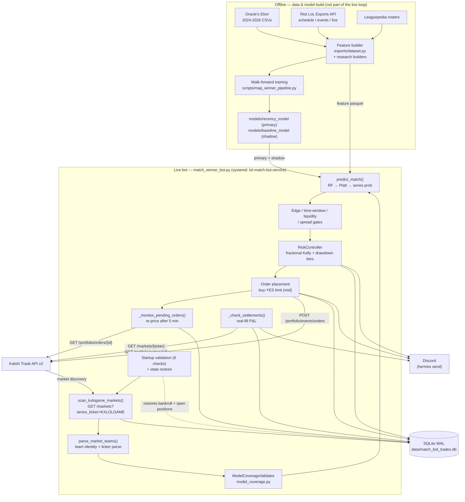

# Architecture — Kalshi LoL Match Winner Trading Bot

> **Status:** reflects the deployed live system as of 2026-10-21.
> The live component is the **LoL match-winner bot** (`src/prediction_bot/trading/match_winner_bot.py`), deployed as `lol-match-bot.service`, trading Kalshi `KXLOLGAME` markets.
> A related per-*map* winner component ("Model D", `KXLOLMAP`) exists in the repository as a shadow candidate and is **not** live.
> The Polymarket→Kalshi copy-trading system is deliberately **out of scope** for this document.

---

## 1. System Overview

The system is a single-process, single-threaded trading bot that loops on a schedule:

1. **Scan** Kalshi `KXLOLGAME` markets for open match-winner markets.
2. **Predict** a calibrated series-winner probability for each matchup.
3. **Filter** through coverage, edge, time-window, liquidity, and risk gates.
4. **Execute** a buy-YES limit order when an edge threshold is met.
5. **Settle** on resolution using real fill data and update the persistent bankroll.
6. **Alert** to Discord throughout.

All state is persisted to SQLite so the bot can restart safely without losing its bankroll or duplicating open positions.

## 2. Architecture Diagram

## 3. Components and Responsibilities

### 3.1 Match-winner bot (`src/prediction_bot/trading/match_winner_bot.py`)

The single executable entrypoint for live trading. ~2,060 lines, self-contained. Responsibilities:

- **Startup validation** (`run_startup_validation`): six checks before any order can be placed — (1) Hermes gateway service health, (2) Kalshi API connectivity/exchange-active, (3) market discovery (a `KXLOLGAME` market is reachable), (4) model loads from pickle, (5) risk engine initializes, (6) Kalshi client can authenticate. Any failure halts the bot.
- **State restore** (`_restore_bankroll`, `_restore_pending_positions`): rebuilds the bankroll from the last settled trade or bankroll snapshot, and re-registers open positions so a restart does not duplicate orders.
- **Scan loop** (`run`, `_scan_cycle`): continuous scanning on a fixed ~2-minute cadence (see §4).
- **Prediction** (`predict_match`): builds a feature vector from the mean of the teams' historical matches in the feature parquet, predicts both directions (A-as-blue, B-as-blue) and averages for symmetry, Platt-calibrates, then converts map→series probability.
- **Order lifecycle** (`_monitor_pending_orders`): re-prices stale unfilled YES orders after 5 minutes.
- **Settlement** (`_check_settlements`): resolves settled markets from real fill data and updates bankroll.
- **Notifications** (`discord_send`, `discord_trade_executed`, `discord_alert`, `discord_daily_summary`): alerts via the Hermes gateway (`hermes send --to discord`).

### 3.2 Kalshi client (`src/prediction_bot/kalshi/client.py`, `signing.py`)

Authenticated HTTPS client for Kalshi's Trade API v2.

- **Auth**: RSA-PSS request signing (`signing.py` — verbatim implementation of Kalshi's prescribed algorithm; keys/signatures never logged). Fallback bearer-token and unauthenticated modes exist.
- **Rate limiting**: token-bucket limiter (`KalshiRateLimiter`) plus tenacity exponential-backoff retries.
- **Endpoints**: market listing/discovery, order books, settlements, fills, events, and (via the generic `_request`) authenticated order placement and portfolio queries.

> Note: the module docstring still says "read-only … no order submission," but the live bot uses the generic `_request` method for `POST /portfolio/events/orders`. The docstring is stale; order placement is a real, exercised path.

### 3.3 Market discovery & classification (`src/prediction_bot/kalshi/discovery.py`)

Esports market identification and game classification (keyword/ticker-based). Also detects and filters multi-event/parlay markets (`KXMVESPORTSMULTIGAME`, `KXMVECROSSCATEGORY`, comma-count heuristic) that cannot be matched to a single event.

### 3.4 Model coverage validator (`src/prediction_bot/trading/model_coverage.py`)

Rejects trades where the model has insufficient training coverage for either team. Teams with `< 50` games are "partial" (rejected); `< 25` games are pure-noise and rejected outright. This replaces coarse league-based filtering with feature-level coverage checks.

### 3.5 Team identity (`src/prediction_bot/trading/team_identity.py`)

Team-name normalization and identity resolution (used by the coverage validator) so market titles/tickers map consistently to the training universe.

### 3.6 Models

| Path | Role | Details |
|------|------|---------|
| `models/recency_model/model.pkl` | **Primary (live)** | `recency_2.0`, Random Forest (200 trees) + Platt calibration, 30 features, trained on 2025 + H1 2026, OOB ≈ 0.639 |
| `models/baseline_model/model.pkl` | **Shadow** | `baseline_1.0`, 30 features, trained 2024–2025, eval on 2026 (acc ≈ 0.630) — used only for divergence detection |
| `models/map_winner_v2_shadow/model.pkl` | **Shadow candidate (not live)** | "Model D", 48 features (incl. Bayesian player-champion and player-matchup), RF + Platt |
| `models/map_winner_pre_draft/`, `map_winner_post_draft/` | Map-winner research models | 17 / 30 features respectively; for per-map (`KXLOLMAP`) prediction |

Model pickles carry their `scaler`, feature column list, and Platt calibrator, so inference does not depend on training code. A fallback path (`_train_model_from_scratch`) rebuilds a model from `data/tier1_features.parquet` only if all pickles fail to load (disaster recovery).

### 3.7 Data sources

| Source | Module | Purpose |
|--------|--------|---------|
| Oracle's Elixir | `esports/dataset.py` + root CSVs | Historical match data → features (team form, Elo, objective/stat differentials) |
| Riot LoL Esports API | `esports/lolesports_client.py` | Schedule, leagues, events, live draft (persisted GW + live stats feed) |
| Leaguepedia | `esports/leaguepedia_rosters.py` | Roster data for player-level features |
| Cito API | (via `data/tier1_features_cito.parquet`) | Optional alternative feature provider (`FEATURE_PROVIDER=cito`) |
| Kalshi Trade API v2 | `kalshi/client.py` | Market discovery, order books, execution, settlement |

Feature matrices live in `data/tier1_features.parquet` (OE) and `data/tier1_features_cito.parquet` (Cito). The running service defaults to `FEATURE_PROVIDER=oe`.

> **Runtime vs. offline split:** the *live* bot's inputs are (1) the Kalshi API and (2) the precomputed feature parquet — it does **not** call the Riot/Leaguepedia/Cito APIs at runtime. Riot, Leaguepedia, and Cito feed the **offline** feature/model build (and the non-live map bot's draft data). `lolesports_client.py`, `leaguepedia_rosters.py`, and `map_winner_model.py` are used by those offline/shadow paths, not by `match_winner_bot.py`.

## 4. End-to-End Workflow

### 4.1 Startup

1. Parse args; `--validate-only` runs the six startup checks and exits.
2. `MatchWinnerBot.__init__` opens SQLite, restores bankroll and open positions, registers signal handlers.
3. `run()` runs startup validation; any failure → `BotState.HALTED` + Discord error alert.
4. Load primary + shadow models.

### 4.2 Scan cycle (`_scan_cycle`)

1. **Pending-order monitor** — re-price unfilled YES orders older than 5 minutes.
2. **Kalshi health** — if exchange/trading inactive, pause execution (`EXECUTION_PAUSED`) and alert.
3. **Risk gate** — drawdown halt check.
4. **Discover** — `scan_kxlogame_markets()` fetches open `KXLOLGAME` markets.
5. **Evaluate each market**:
   - `parse_market_teams()` → team A/B.
   - Coverage validation (reject under-covered teams).
   - `predict_match()` → raw RF prob → Platt-calibrated prob.
   - Shadow-model divergence check (logs when primary and shadow disagree > 5%).
   - `map_to_series_prob()` → series probability (Bo3 default in the live path; the function also supports Bo5).
   - Edge = calibrated series prob − market mid.
   - Gates: match within 2 hours, spread ≤ 10%, minimum order-book depth, edge ≥ 3%, position ≥ $1.
   - `RiskController.size_position()` → Kelly size.
6. **Select** the best candidate per event (one side per match, no duplicate/opposite positions).
7. **Execute** — buy-YES limit order at mid (or marketable price), `side=bid`, `time_in_force=good_till_canceled`, self-trade prevention `taker_at_cross`.
8. **Log** scan, prediction, and trade rows; snapshot bankroll.

### 4.3 Settlement (`_check_settlements`)

For each executed-but-unsettled trade:

1. Query the market; if not settled, skip.
2. Fetch **real fill data** from `/portfolio/orders/{id}` (taker + maker fill cost and count).
3. Determine win/lose from the market `result`.
4. P&L = `fill_count × $1 − cost` (win) or `−cost` (loss).
5. Update trade row, release the event reservation, update bankroll, snapshot, and alert.

### 4.4 Scan cadence and window (`is_scanning_window`)

- The main loop runs one scan cycle every **~120 seconds** while inside the 08:00–24:00 CST scanning window (`is_scanning_window`), and sleeps 600 seconds outside it.
- `get_scan_interval()` (an adaptive 2h/1h/15min schedule keyed to match close time) is defined in the file but **is not called by the main loop** — the live cadence is the fixed ~2-minute cycle.

## 5. Key Data Structures and Persistence

### 5.1 SQLite schema (`data/match_bot_trades.db`, WAL mode)

- **`trades`** — one row per order: ticker, side, raw/calibrated prob, market price, edge, Kelly fraction, position size, bankroll before/after, `execution_result` (e.g. `http_201|orders=ID1,ID2`), `settlement_result`.
- **`bankroll`** — time-series snapshots: bankroll, peak, drawdown, Kelly fraction.
- **`scans`** — per-cycle counts (discovered/evaluated/opportunities).
- **`predictions`** — every model prediction + decision + rejection reason.
- **`alerts`** — alert log.

### 5.2 Feature matrix

- `data/tier1_features.parquet` (OE) / `data/tier1_features_cito.parquet` (Cito): one row per match, leakage-safe features (only data available before match start).

### 5.3 Logs

- journald (`lol-match-bot.service`) + `data/logs/match_bot.log` (rotating).

## 6. API Dependencies

| API | Base | Auth | Use |
|-----|------|------|-----|
| Kalshi Trade API v2 | `https://external-api.kalshi.com/trade-api/v2` | RSA-PSS signed | market discovery, order books, execution, settlement, fills |
| Riot LoL Esports (persisted GW) | `https://esports-api.lolesports.com/persisted/gw` | public API key | schedule, leagues, events |
| Riot LoL Esports (live) | `https://feed.lolesports.com/livestats/v1` | public API key | live game window / draft |
| Leaguepedia | Cargo/API | public | rosters |
| Cito API | `api.citoapi.com/api/v1` | `x-api-key` | alternative esports match data (optional, offline) |

> The Cito client code is **not present in this repository** — Cito features are consumed only via the precomputed `data/tier1_features_cito.parquet` (and a parity-check script `new_model_parity.py`). The base URL above is from external notes, not verifiable in-repo; confirm before relying on it.

Kalshi's `outcome_side` field is deprecated, so all orders are placed as `side=bid` buying the YES contract.

## 7. Runtime and Deployment

- **Process**: `.venv/bin/python -m prediction_bot.trading.match_winner_bot --live`
- **Service**: `lol-match-bot.service` — `Restart=always`, `RestartSec=10`, `NoNewPrivileges`, `PrivateTmp`, TZ `Asia/Shanghai`, logs capped (100 MB, rate-limited).
- **Dependencies**: `hermes-gateway.service` (Discord messaging), network.
- **Not running**: `lol-match-platform.service` ("Unified Platform v2" shadow mode, disabled); the map bot `research/map_winner_v2/map_bot_v2.py` (watchdog cron not installed).

## 8. Reliability and Risk Controls

### 8.1 Duplicate-order prevention

- Ticker-level dedup (`_active_tickers`) plus event-level reservation (`_open_events`) — one position per match.
- On restart, `_restore_pending_positions()` re-registers all executed/unsettled positions from SQLite before the first scan, so re-discovery of the same markets does not double-buy.

### 8.2 Persistent state / restart recovery

- Bankroll restored from the last settled trade's `bankroll_after`, else the newest `bankroll` snapshot, else the configured initial value.
- Open positions restored from `trades` rows with `http_201`/`pending_approval` and no settlement.

### 8.3 Risk gates (in `RiskController`)

| Control | Value |
|---------|-------|
| Initial bankroll | $50 (configured constant) |
| Kelly fraction (normal) | 0.375 (Tier-B reduced) |
| Kelly — cautious tier | 0.25 (drawdown ≥ 20%) |
| Kelly — defensive tier | 0.10 (drawdown ≥ 35%) |
| Drawdown halt | 50% |
| Max position | 10% of bankroll |
| Min edge | 3% |
| Min trade | $1.00 |
| Max spread | 10% of mid |

### 8.4 Failure points and existing safeguards

| Failure point | Safeguard |
|---------------|-----------|
| Kalshi API down / maintenance | `check_kalshi_health()` pauses execution; startup validation gates launch |
| Model pickle missing/corrupt | falls back to baseline model, then trains from scratch (last resort) |
| Under-covered teams | coverage validator rejects before sizing |
| Stale unfilled orders | re-price after 5 min; unfilled orders do not block new signals |
| Duplicate orders across restarts | ticker + event reservations restored from DB |
| Drawdown blowup | three-tier Kelly reduction → hard halt at 50% |
| Inconsistent exchange/local state | settlement reads real fill cost/count from Kalshi, not local theoreticals |

## 9. Architecture Trade-offs

- **Single process, single thread** — simple to reason about and deploy, but no parallelism; a blocking API call stalls the whole loop (mitigated by timeouts and retries).
- **Deterministic risk checks instead of an LLM review layer** — the original plan (`docs/task_plan.md` M11) called for a Hermes decision agent; the live system uses explicit, testable rules instead (lower variance, easier to audit).
- **Pickle-serialized models with inlined scaler/calibrator** — inference is decoupled from training code, at the cost of opaque artifacts (mitigated by `FREEZE_SPEC.md` and metadata.json).
- **Buy-YES only** — avoids Kalshi's deprecated `outcome_side`; "bet against team" means buying the opposing YES contract.
- **Map→series conversion** — reuses a map-level model for series markets (OE labels maps), avoiding a separate series-level model at the cost of the independence assumption.

## 10. Known Limitations

- Map-level labels vs. series-level markets (Bo3 assumption; no momentum/tilt modeling).
- Single RF model family; no ensemble or uncertainty estimate in the live path.
- No fee/slippage model in edge beyond the spread.
- No cross-series exposure netting beyond per-event limits.
- Backtest metadata for the map models shows unbounded compounding (unrealistic bankroll figures) — not representative of live returns.
- The generic `_request` order path in `kalshi/client.py` lacks the dedicated safety scaffolding that `trading/order_client.py` provides for other bots.
- No external kill-switch beyond in-process drawdown halt + startup validation.

## 11. Out of Scope

The Polymarket→Kalshi **copy-trading** system (`src/prediction_bot/copy_trading/`, `*_copy_bot` services, their DBs) and other unrelated strategies are not part of this document. Legacy paper-trading prototype modules (`agents/`, `auto_trader.py`, `pipeline.py`, `service.py`, `executor.py`, `strategy*.py`, `monitoring/`, `storage/`) predate the live bot and are superseded by `match_winner_bot.py`; the paper prediction tracker (`tracking/`) remains an independent non-live tool.
